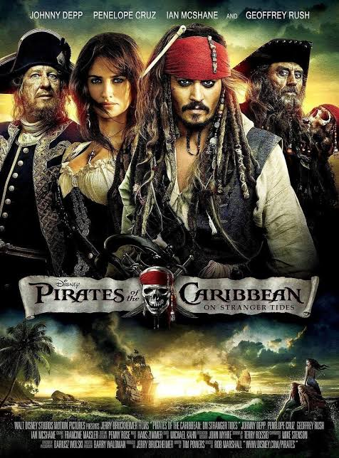

# app-dev
My first repository.

# My Favorite Movie: Pirates of the Caribbean

## About the Movie

**Pirates of the Caribbean: On Stranger Tides** is a 2011 adventure and fantasy movie starring Johnny Depp as Captain Jack Sparrow.

The story follows Captain Jack Sparrow as he searches for the legendary Fountain of Youth. Along the way, he encounters dangerous pirates, mermaids, and the infamous pirate Blackbeard.

## Why I Like This Movie

I like this movie because of its exciting pirate adventures, interesting characters, epic sword fights, and funny moments. Captain Jack Sparrow is my favorite character because of his cleverness, humor, and unique personality.

## Main Characters

- **Captain Jack Sparrow** – A clever and unpredictable pirate.
- **Angelica** – A mysterious woman from Jack's past.
- **Blackbeard** – A dangerous and powerful pirate.
- **Hector Barbossa** – A famous pirate captain.

## Movie Information

| Category | Details |
|---|---|
| Movie Title | On Stranger Tides |
| Release Year | 2011 |
| Genre | Adventure, Fantasy, Action |
| Main Actor | Johnny Depp |
| Main Character | Captain Jack Sparrow |
| Director | Rob Marshall |

## My Favorite Things

1. Captain Jack Sparrow's funny personality.
2. The exciting pirate battles.
3. The treasure-hunting adventure.
4. The beautiful ships and ocean scenes.

## Conclusion

Pirates of the Caribbean is my favorite movie because it combines adventure, comedy, action, and fantasy. It is a movie that I can watch over and over again.
